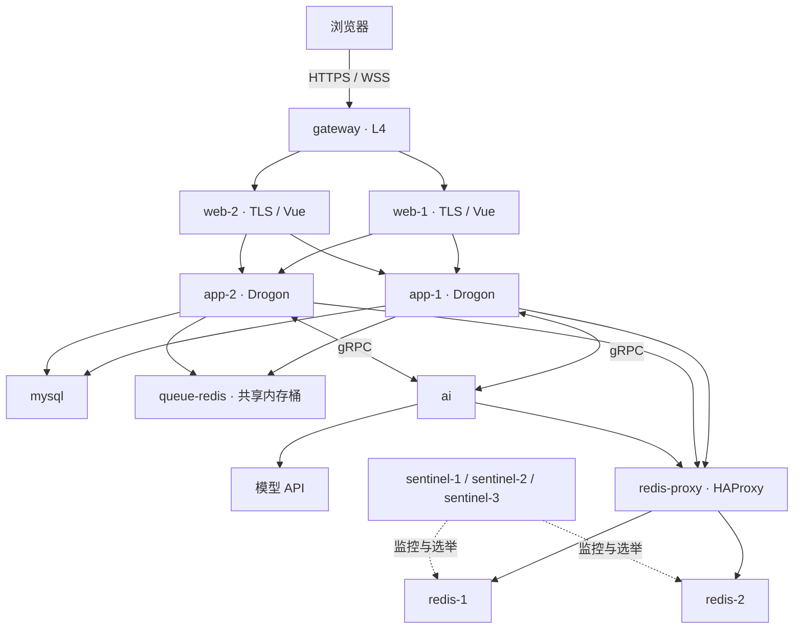

# 基于 C++ 的实时高可用 AI 通讯系统

文档入口见[项目文档索引](docs/README.md)。

面向多人群聊的实时通信系统：多实例接入、跨实例推送、Redis 主从自动切换、切换期间请求暂存，房间里还可以有多个由用户自己创建的 AI 成员。行为规格在 `openspec/specs/`，各阶段的设计在 `openspec/changes/archive/`。

## 功能概览

- **实时群聊**：WebSocket 推送、按 `seq` 有序、断线补齐、离线重试去重；未读数、“有人@我”、关键词/发送者/时间搜索（中文走 ngram 全文索引）。
- **房间管理**：邀请、群主转让、管理员、踢出与封禁。
- **账号安全**：密码强度与常见密码检查、按地址和按用户名双重限流、受信任设备、安全问题找回密码。
- **AI 成员**：用户在 DeepSeek、GPT、Claude、Gemini 四类模型上创建私有角色，每个房间单独设置人设；谁触发谁付费（用户自己的 API key，加密保存）；流式输出、停止与房间暂停、失败重试和中断恢复。
- **高可用**：L4 网关 + 双 L7 + 双应用实例，Redis 1 主 1 从 + 3 Sentinel 自动选举，HAProxy 只转发到当前主节点；切主期间业务请求进入共享暂存桶，恢复后限速执行，客户端凭排队编号查询最终结果。
- **可观测**：结构化阶段日志，HTTP/WS/队列/SQL/Redis/AI 用请求编号关联。

## 架构



- `gateway` 是唯一发布 HTTP/HTTPS 端口的服务；它按源 IP 一致性哈希到 L7，并保留真实地址。本机单节点部署下 L4 仍是单点。
- `web-1`、`web-2` 结束 TLS、提供静态文件并代理到两个应用。普通 HTTP 保留上游连接池；WebSocket 使用同样的两个应用、独立的新上游连接，以适配 Drogon 1.9.13 的首次请求升级限制。
- `app-1`、`app-2` 共用镜像及 MySQL/Redis 状态，任一实例都能处理会话和房间请求。日志仅记方法、路径、状态，不记录 Cookie 或请求体。
- `queue-redis`是独立单实例纯内存共享桶，供两个后端暂存切换期间的业务及结果；与业务Redis主从分开，重启可能丢任务，入桶不代表成功。
- `ai` 通过 gRPC 与两个应用交互；`redis-proxy` 只路由到当前 Redis 主节点，3 个 Sentinel 自动选举。服务详见下面 Redis 章节。
- `certs`、`migrate`、`db-users` 是一次性准备服务，分别生成本地证书、执行迁移、配置 AI 数据库账号；`tests` 只在 test profile 下运行。

- C++ 聊天服务负责账号、房间、消息和推送；AI 的最终回复也由它保存，`seq` 只在这里分配。
- Python AI 服务决定 AI 什么时候说话、由哪个 AI 说，调用模型并流式输出，同时负责 API key 的加解密。它的状态都在 Redis，进程本身无状态。
- 两者通过 `proto/ai.proto` 定义的 gRPC 双向流通信。AI 服务停止时，人和人之间的聊天不受影响，重连后补回期间的事件。

## 一键启动

需要 Docker。先创建 `.env`，把里面的 `change-me` 都换成自己的密码。`.env` 不进 Git，缺少必填项时 Docker Compose 会拒绝启动。

```bash
cp .env.example .env
```

共享暂存还需要独立的`QUEUE_REDIS_PASSWORD`、`QUEUE_ENCRYPTION_KEY`和`BUFFER_CONTROL_TOKEN`，各自用一次`openssl rand -hex 32`生成，不能复用模型API key或其他密码；已有环境保留原`.env`的值，只补缺少的项。代理和共享桶使用动态分配池之外的固定地址；自定义网段时须同时修改对应地址和动态池，详见[请求暂存与恢复](docs/request-buffering.md)。

```bash
docker compose up -d --build --wait
```

启动后访问 <https://localhost:8443>，用下面的命令确认 MySQL 和 Redis 正常：

```bash
curl --cacert data/certs/ca.crt https://localhost:8443/health
```

首次启动由 `certs` 容器生成本地 CA 和服务器证书，保存在不进 Git 和 Docker 构建上下文的 `data/certs/`。再次启动沿用已有证书；服务器证书不足 30 天有效期或 SAN 变化时，只重新签发服务器证书。私钥请勿分享。

macOS 上打开“钥匙串访问”，将 `data/certs/ca.crt` 导入“登录”钥匙串，双击 **CppAiServer Local CA**，展开“信任”，将“使用此证书时”设为“始终信任”。完成系统确认后重新打开浏览器，访问 `https://localhost:8443` 应没有证书警告。其他系统需将同一个 CA 导入其受信任根证书库。命令行用上面的 `--cacert` 即可，无需关闭证书校验。

HTTP 入口 `http://localhost:8080` 仅做 301 跳转，不处理登录或 WebSocket。`HTTP_PORT`、`HTTPS_PORT` 可配置；修改 HTTPS 端口时须同步 `ALLOWED_ORIGINS`。Cookie 默认带 `Secure`、`HttpOnly`，仅在直接通过 HTTP 调试内部应用时才使用 `COOKIE_SECURE=0`。`GATEWAY_CONN_PER_IP` 默认 100，按真实客户端地址限制包括 WebSocket 在内的 TCP 并发连接。

数据库结构来自 `migrations/`，由 [Flyway](https://documentation.red-gate.com/flyway) 管理。每次启动时 `migrate` 服务先执行还没执行过的迁移，记录在 `flyway_schema_history` 表里，完成后应用才会启动。Flyway 之前建的库会自动登记为版本 1。

修改表结构时新增一个文件，按 `V<版本>__<说明>.sql` 命名，例如 `migrations/V12__add_message_reactions.sql`（当前最新为 V11）。不要修改已执行过的文件，Flyway 会校验文件的校验和，不一致时拒绝执行。MySQL 的 DDL 不能回滚，一个迁移中途失败时，`migrate` 会停下并让应用不启动，需要手动修正数据库，再用 `repair` 清掉失败记录后重启。

查看迁移状态，或在修正后清理失败记录：

```bash
docker compose run --rm migrate info
```

```bash
docker compose run --rm migrate repair
```

Flyway 镜像只带 MariaDB 驱动，所以连接地址是 `jdbc:mariadb://`，它可以连接 MySQL 8.4，启动时会提示 8.4 比 Flyway 验证过的版本新，可以忽略。

清空全部数据：

```bash
docker compose down -v
```

修改已有环境的 `MYSQL_PASSWORD` 或 `MYSQL_ROOT_PASSWORD` 时，只改 `.env` 不够，MySQL 的密码保存在数据卷里，要同时用 `ALTER USER` 修改。`AI_MYSQL_PASSWORD` 例外：`db-users` 服务每次启动都会用 root 把 `ai` 账号的密码同步成 `.env` 里的值。

## 账号与安全

注册时密码至少 10 个字符，不能与用户名相同，也不能是常见密码。常见密码列表在 `data/common-passwords.txt`，取自 [SecLists](https://github.com/danielmiessler/SecLists) 的 `Passwords/Common-Credentials/xato-net-10-million-passwords-100000.txt`（MIT 许可），只保留长度至少 10 的条目并转为小写。

注册时可以设置一个安全问题和答案，忘记密码时在登录页点“忘记密码”，输入用户名取回问题，答对后设置新密码。答案像密码一样只保存慢哈希；比较时忽略首尾空格（含全角空格）且不区分英文大小写。重置成功会结束这个用户在所有设备上的会话。没有设置安全问题的旧账号无法自助找回。答错同样计入该用户名的登录失败次数（见下文），问题查询和重置接口也计入 Nginx 的认证限流。

| 方法 | 路径 | 请求 | 响应 |
|---|---|---|---|
| POST | `/api/auth/password-recovery/question` | `{"username"}` | `200 {"question"}`，用户不存在或未设置时为空字符串 |
| POST | `/api/auth/password-recovery/reset` | `{"username","answer","password","password_confirm"}` | `200 {}`；答错为 `401 invalid_answer`，两次密码不一致为 `400 password_mismatch` |

登录、注册和找回密码由 Nginx 按客户端地址限流（共用一个额度），默认每分钟 10 次，可以突发 10 次，超出返回 429 和 `rate_limited`，并带上 `retry_after` 和 `Retry-After` 头，告诉客户端要等几秒。通过 `.env` 的 `AUTH_RATE`、`AUTH_BURST` 和 `AUTH_RETRY_AFTER` 调整，改 `AUTH_RATE` 时把 `AUTH_RETRY_AFTER` 设为 60 除以每分钟次数。

应用还按用户名延迟登录，与客户端地址无关：每个用户名有 5 次免费尝试，之后要等 1、2、4 秒……最多 60 秒才能再试，期间返回 429 和 `too_many_attempts`，带 `retry_after`，不校验密码。登录成功会清零，15 分钟没有新尝试也会清零，不会锁号。登录成功的浏览器会收到 `chat_device` Cookie（180 天），之后这台浏览器单独计数，别人猜这个用户名不会拖慢它。这些数值都在 `.env` 的 `LOGIN_*` 和 `DEVICE_TTL_DAYS` 里。

每个用户每 10 秒最多发 30 条消息，所有连接和房间合计，超出的消息返回 `rate_limited` 和 `retry_after`，不会保存，之后可以用同一个 `client_msg_id` 重发。数值在 `.env` 的 `MESSAGE_RATE_*` 里。

### 会话与受信任设备

- 会话默认 7 天（`SESSION_TTL_SECONDS`）。登出或会话过期后，已打开页面的 WebSocket 会以关闭码 `4401` 断开，前端回到登录页：登出时立即断开，过期时在 `SESSION_CHECK_SECONDS`（默认 30 秒）内断开。
- 每个用户最多有一台受信任的手机和一台受信任的电脑（按浏览器的 User-Agent 判断，平板算手机）。某类的第一台设备登录后直接受信任；之后另一台同类设备最近 30 天发的消息超过原设备的 1.5 倍时，它在登录或续期时替换原设备。
- 从受信任设备登出会结束这个用户在所有设备上的会话；从其他设备登出只结束当前会话。
- 受信任设备的前端每 6 小时调用一次 `POST /api/auth/refresh`，会话不会过期；其他设备的会话照常 7 天过期。

## 房间踢人与封禁

| 操作者 | 管理员 | 普通成员 | 房间外的用户 |
|---|---|---|---|
| 群主 | 可踢出、封禁 | 可踢出、封禁 | 可封禁 |
| 管理员 | 不可操作 | 可踢出、封禁 | 可封禁 |
| 普通成员 | 不可操作 | 不可操作 | 不可操作 |

不能对自己执行踢出或封禁，群主也不能被其他人移出；离开使用“退出房间”，群主需先转让所有权。AI 使用已有的“移出 AI”，不能走人类成员踢出接口。

被踢出者可再次被邀请，重新加入时是普通成员；旧消息保留。封禁会同时移出成员、取消未接受的邀请，并阻止再次邀请和加入，直到群主或管理员解封。解封不自动恢复成员关系或邀请。所有实例上的连接都会收到带 `kicked` 或 `banned` 原因的 `room_left`，其余在线成员刷新成员列表。

成员面板按权限显示“踢出”“封禁”，两者都需要确认用户名。群主和管理员还能打开封禁列表、按用户名封禁房间外的人或解封。列表保留执行者退出房间前的姓名；只有执行者账号被删除时显示为空。

| 方法 | 路径 | 响应 |
|---|---|---|
| DELETE | `/api/rooms/{id}/members/{username}` | `200 {}` |
| PUT | `/api/rooms/{id}/bans/{username}` | `200 {}`，重复封禁保留原记录 |
| DELETE | `/api/rooms/{id}/bans/{username}` | `200 {}`，解封幂等 |
| GET | `/api/rooms/{id}/bans` | `200 {"bans":[{"username","banned_by","created_at"}]}` |

用户名须进行 URL 编码。封禁列表按时间升序，`created_at` 是 Unix 毫秒时间戳，`banned_by` 是用户名或 null。非成员访问返回 `room_not_found`，权限不足为 `forbidden`，邀请被封禁者返回 `409 user_banned`。

## AI

### 密钥和账号

`.env` 里有三个 AI 相关的密钥，`.env.example` 的注释里写了生成方法：

| 变量 | 用途 | 谁能看到 |
|---|---|---|
| `AI_GRPC_TOKEN` | C++ 和 AI 服务之间 gRPC 的共享令牌 | app、ai |
| `AI_KEY_ENCRYPTION_KEY` | 加密用户 API key 的主密钥（AES-256-GCM），丢失后已保存的 key 全部无法解密 | 只有 ai |
| `AI_MYSQL_PASSWORD` | AI 服务的 MySQL 账号 `ai` | db-users、ai |

`ai` 账号由一次性的 `db-users` 服务创建，只能读写 `user_api_keys` 和 `ai_generations`（不能删除）、读和新增 `room_ai_controls`、读 `ai_profiles`、`ai_model_types`、`room_ai_personas` 和 `messages`，以及读 `members` 的 `id`、`type`、`display_name` 三列。授权以 `scripts/db-users.sh` 为准。root 密码只给 MySQL 和 `db-users`。

### 填写 API key 和邀请 AI

1. 登录后点左上角的“设置”，按服务商填写 API key。保存前会先向服务商验证，之后只显示末 4 位。
2. 在房间里点“成员”，在“我的AI”里选底层模型、起名创建自己的角色。角色是私有的，只有创建者能邀请，邀请时填写本房间的人设，之后也只有创建者能修改。群主和管理员邀请自己的角色时直接加入；普通成员提交申请，由群主或管理员审批。邀请人必须有对应服务商的 key。创建者退出、被踢或被封禁时，他的 AI 一起离开房间，聊天记录保留。详见[私人AI角色与房间人设](docs/private-ai-personas.md)。
3. 只有一个人的房间里，AI 回复你的每条消息，冷场时还会主动说话，第 3 条主动发言是告别；多人房间里，用 `@` 选择 AI 成员才会回复，重名时按选中的成员区分。完整规则见 `openspec/specs/ai-replies/spec.md`。

DeepSeek 默认使用 `deepseek-flash`，并在调用时显式关闭思考模式，减少日常聊天的 token 开销。模型与定价以 [DeepSeek 官方价格表](https://api-docs.deepseek.com/quick_start/pricing/) 为准。

四类底层模型的型号和旧版预置 AI 的默认人设在 `ai/agents.toml`（旧版预置 AI 只保留在已有房间里，不能再新邀请），改完运行 `docker compose up -d --build --wait ai` 重新构建并启动 AI 服务。模型名要按各家当时可用的型号填写。国内网络访问 OpenAI、Anthropic、Gemini 可能需要代理，适配器支持修改 `base_url`。

行为参数（都在 `.env`）：`AI_CHAIN_P`（AI 之间接话的起始概率）、`AI_PROACTIVE_P1`（主动发言的概率）、`AI_IDLE_SECONDS`（冷场多久算冷场）、`AI_CONTEXT_MESSAGES`（带多少条历史）、`AI_GENERATION_TIMEOUT`（单次生成超时秒数）。

### 未读、搜索和 AI 控制

房间列表显示未读数和“有人@我”，房间内可按关键词、发送者和时间搜索。群主和管理员可以暂停或恢复房间里的 AI，触发者本人也可以停止自己引发的回复，已输出的部分会保存为带“已停止”标记的消息。接口、并发语义和结构化日志见[聊天阅读、搜索与 AI 控制](docs/chat-controls.md)。

### AI 回复恢复

房间事件的状态和待生成任务原子保存后才确认，C++ 会重发超时未确认的事件。AI 服务中断后，Redis 中的未完成任务在租约到期后自动恢复，重新生成可能再次产生服务商费用。缺 key 或 key 被拒绝时直接提示用户更新。

`AI_GENERATION_MAX_ATTEMPTS` 控制每条回复的总尝试次数（默认 3），`AI_RETRY_BASE_SECONDS` 控制退避基数（默认 1 秒），`AI_WORK_LEASE_SECONDS` 控制任务租约（默认 10 秒，运行中自动续期）。完整结果会重投直到 C++ 确认保存，重复投递按 `generation_id` 去重。

冷场任务开始前会检查用户是否已重新发言。已开始的冷场回复可以完成，后来的用户消息随后正常回复。主动发言用三个成功位记录，只在消息保存成功后置位，三位全为 1 时结束。

浏览器从实时推送和历史查询得到正式消息时都会清除对应草稿。流式片段携带尝试编号和累计文本，重试及重连后能替换旧草稿。`scripts/test.sh` 包含 Python 单元测试与生成中重启 AI 服务的故障测试。

本机运行完整故障测试时应保持 Docker Desktop 的时钟连续。脚本在 macOS 测试进程存活期间用 `caffeinate` 防止空闲休眠；测试准备会等 Sentinel 退出 TILT，实际主节点故障后的恢复仍按 30 秒验收。暂停虚拟机或强制系统休眠仍会影响计时。

### 不用真实 key 在本地试

设置 `AI_FAKE_PROVIDERS=1` 后，所有服务商都换成一个假模型：以 `fake-` 开头的 key 都能通过验证，回复内容是“AI 名字: 最后一条消息”。测试和 CI 都用这种方式，不会调用真实的服务商。

```bash
AI_FAKE_PROVIDERS=1 AI_IDLE_SECONDS=20 docker compose up -d --build --wait
```

这只用于本地试用，公开部署时不要打开。

公开部署时，把 `ALLOWED_ORIGINS` 改成实际域名，并在 HTTPS 下设置 `COOKIE_SECURE=1`。

## Redis 自动故障切换

应用和 AI 统一连接 `redis-proxy:6379`（HAProxy），它只转发到回答 `role:master` 的节点。`redis-1`/`redis-2` 是两个数据节点，初次启动由 redis-1 任主；3 个 Sentinel 以 quorum 2 监控，默认 3 秒判定下线，再自动提升从节点。Sentinel 的配置分别保存在具名卷中，重启沿用选举后的状态。

手动演示（以下假定当前主节点为 redis-1，先查询确认）：

```bash
docker compose exec redis-2 redis-cli -h sentinel-1 -p 26379 SENTINEL get-master-addr-by-name chat
docker compose exec redis-2 redis-cli -h redis-proxy INFO replication
docker compose stop redis-1
```

等待数秒，再运行查询。代理应连接 redis-2，应用和 AI 不需重启：

```bash
docker compose exec redis-2 redis-cli -h redis-proxy INFO replication
curl --cacert data/certs/ca.crt https://localhost:8443/health
docker compose start redis-1
docker compose exec redis-1 redis-cli INFO replication
```

原主节点会由 Sentinel 降为从节点，最终显示 `role:slave` 和 `master_link_status:up`。若查询显示 redis-2 已是主节点，演示时对调两个节点，不能再次停止已经是从节点的 redis-1 来证明主故障恢复。

启用业务暂存后，暂停期间请求先返回排队编号，由独立内存Redis共享保存；恢复后每实例按50次/秒、8并发初值处理，客户端查询最终业务结果。入队不等于成功，聊天ACK仍在MySQL提交后。共享桶不可用会明确报可重试错误，丢失的任务结果可能是unknown，不能盲重放。主动切主使用`docker compose exec redis-proxy sh /redis-proxy.sh switch`，缺暂停确认就取消。配置、内存边界、查询凭证和恢复矩阵见[请求暂存与恢复](docs/request-buffering.md)。

Redis 异步复制仍可能丢失最后一小段会话、限流或 AI 状态。聊天消息已保存于 MySQL，历史可补齐。Pub/Sub 在断开期间不保留推送，客户端通过 seq 缺口或重连补齐。此部署是 Sentinel 单主，不支持直接换成 Redis Cluster：受信任设备的 Lua key 设计需要届时单独修改。

共享桶版本升级前补齐独立密钥并备份现有配置、证书和数据。网络IPAM有变化时，需要维护窗口：先准备镜像，停止写入并备份，再用`docker compose down`（不加`-v`）重建网络，最后`docker compose up -d --wait`并核对迁移、数据、许可和业务结果。保留现有MySQL、Redis和Sentinel命名卷，不自动删除旧卷或承诺会话一定失效；固定地址约束见[请求暂存专题](docs/request-buffering.md)。

`SENTINEL_DOWN_AFTER_MS` 控制判定下线的时长。测试脚本会在 AI 故障阶段之后执行 Redis 主节点停止、恢复验证、旧主节点重新加入，并用测试专用复制屏障保存跨阶段夹具；产品不承诺 Redis 写入强一致。

## 运行测试

```bash
scripts/test.sh
```

脚本先在容器内运行单元测试，再启动完整环境并运行 `tests/integration` 下的集成测试。传给脚本的参数会交给 pytest，例如 `scripts/test.sh -k rooms`。

测试会频繁注册、登录和发消息，所以脚本分几步：

1. 放开 Nginx 和消息的限制，把登录计数的有效期缩短到 5 秒，AI 服务用假模型、冷场时长 3 秒，运行全部测试。
2. 先准备一个有 AI 的房间，停掉 AI 服务后发一条消息，确认人和人的聊天照常；再启动 AI 服务，确认这条消息在重连后得到且只得到一次回复。
3. 检查日志里没有出现测试用的 API key 明文。
4. 用每 2 秒 5 条的消息限额测试消息限流、AI 之间接话（接话概率设为 1）和 AI 回复不占用户限额，用默认值测试 Nginx 限流。
5. 按正常配置重启。

队列满的测试需要极小的队列，默认跳过。单独运行时，环境变量要在两条命令中都生效：

```bash
export WORKER_COUNT=1 WORKER_QUEUE_LIMIT=1 SMALL_QUEUE=1
docker compose up -d --wait app-1 app-2
docker compose --profile test run --rm tests pytest -q test_faults.py -k full_queue
unset WORKER_COUNT WORKER_QUEUE_LIMIT SMALL_QUEUE
docker compose up -d --wait app-1 app-2
```

### 清理测试数据

集成测试会在数据库里留下大量测试账号和房间。用下面的命令清理，默认只预演并打印数量：

```bash
docker compose --profile test run --rm tests python cleanup_test_data.py
```

确认数量后加 `--apply` 才真正删除，全部在一个事务里完成：

```bash
docker compose --profile test run --rm tests python cleanup_test_data.py --apply
```

- 默认匹配测试生成的用户名：`u` 加 12 位十六进制，或 `用户u` 加 5 位十六进制。
- 其他前缀用 `--prefix` 加入（可重复），`--exclude` 排除前缀，默认排除 `realtest_`。
- 成员全是待删用户的房间整间删除；共享房间里只删待删用户的消息和成员关系，待删用户是群主时，群主转给最早加入的其他人类成员。

## 压测

```bash
docker compose --profile test run --rm tests python load_test.py <房间数> <每房间发送者> <每人消息数>
```

每个发送者等到确认后才发下一条。以下结果来自 2026-11-02 在 Docker Desktop（arm64，10 核，8 GB）上的测试，测试端和服务端在同一台机器上，只能作为相对参考：

| 场景 | 配置 | 吞吐 | p50 | p99 |
|---|---|---|---|---|
| 1 个房间，5 人发送 | `WORKER_COUNT=16` | 465 条/秒 | 10.2 ms | 20.2 ms |
| 32 个房间，各 1 人发送 | `WORKER_COUNT=2` | 1033 条/秒 | 30.2 ms | 41.8 ms |
| 32 个房间，各 1 人发送 | `WORKER_COUNT=8` | 2196 条/秒 | 13.9 ms | 21.7 ms |
| 32 个房间，各 1 人发送 | `WORKER_COUNT=16` | 2772 到 3372 条/秒 | 9.1 到 11.2 ms | 16.3 到 18.3 ms |

全部场景都没有错误。

加入按用户的消息限流后（每条消息多一次 Redis 调用），2026-11-02 在同一台机器上、放宽限额重测两次，`WORKER_COUNT=16`：

| 场景 | 吞吐 | p50 | p99 |
|---|---|---|---|
| 1 个房间，5 人发送，各 200 条 | 936 到 943 条/秒 | 5.0 ms | 10.4 到 10.7 ms |
| 32 个房间，各 1 人发送，各 200 条 | 4604 到 4611 条/秒 | 6.6 ms | 11.7 到 11.8 ms |

吞吐没有下降，反而比上表高，但两次测试时机器的负载不同，这个差别不能归因于代码，只能说明多出的 Redis 调用没有造成明显下降。压测时需要放宽限额：

```bash
export AUTH_RATE=100000r/m AUTH_BURST=100000 MESSAGE_RATE_LIMIT=100000
docker compose up -d --wait
```

默认值：

- `WORKER_COUNT=16`：测试过的配置里吞吐最高。`MYSQL_CONNECTIONS=24` 比它多 8 个连接，留给 HTTP 接口。
- `WORKER_QUEUE_LIMIT=1024`：单个 worker 约每秒处理 500 条，排满时最多积压约 2 秒。超过后返回可重试错误。
- `HOT_CACHE_SIZE=200`：足够覆盖两页最大分页，这个值按分页大小确定，没有压测。

## CLion 开发

日常开发在容器内构建，和部署使用同一份依赖。

1. 构建开发镜像：

   ```bash
   docker build --target dev -t cppaiserver-dev .
   ```

2. 打开 Settings > Build, Execution, Deployment > Toolchains，新建 Docker 工具链，Image 选择 `cppaiserver-dev:latest`。
3. 在 Settings > Build, Execution, Deployment > CMake 中把工具链切换为刚建的 Docker 工具链。
4. 用 `docker compose up -d mysql redis-1 redis-2 sentinel-1 sentinel-2 sentinel-3 redis-proxy queue-redis` 启动依赖。运行配置的容器参数加上 `--network cppaiserver_default`，环境变量设置 `MYSQL_PASSWORD` 和 `REDIS_PASSWORD`，取值和 `.env` 相同。

## 目录

| 路径 | 内容 |
|---|---|
| `docs/` | 架构、接口、配置与测试说明 |
| `src/` | C++ 后端 |
| `web/` | Vue 前端 |
| `ai/` | Python AI 服务：触发规则、模型适配器、key 加密 |
| `proto/` | C++ 和 AI 服务共用的 gRPC 接口 |
| `migrations/` | 数据库迁移，由 Flyway 执行 |
| `docker/` | Nginx 配置和 Drogon 补丁 |
| `scripts/` | 测试脚本、`ai` 账号的授权脚本 |
| `tests/` | 单元测试和集成测试 |

## Drogon 补丁

镜像构建时会给 Drogon 1.9.13 打上 `docker/drogon-mysql-disconnect.patch`。未打补丁时，MySQL 不可达会让应用在 `MysqlConnection::disconnect()` 中段错误退出。

还会打上 `docker/drogon-redis-disconnect.patch`。Drogon 1.9.13 跨线程发送 Redis 命令时，排队的任务只持有连接的裸指针；如果连接在这期间断开，hiredis 会先释放上下文，排队的发送随后访问已释放的内存，表现为 Redis 故障切换窗口里后端偶发 `It is forbidden to run loop on threads other than event-loop thread` 后退出，或 `malloc(): ... corrupted`。补丁让排队任务持有连接的所有权，并让断开后的发送、订阅直接以 `Connection is broken` 失败。

## Contributors

本项目由开发者与以下 AI 编程工具协作完成代码实现、评审、测试和文档整理：

- **Codex**（OpenAI）
- **Claude Code**（Anthropic）
