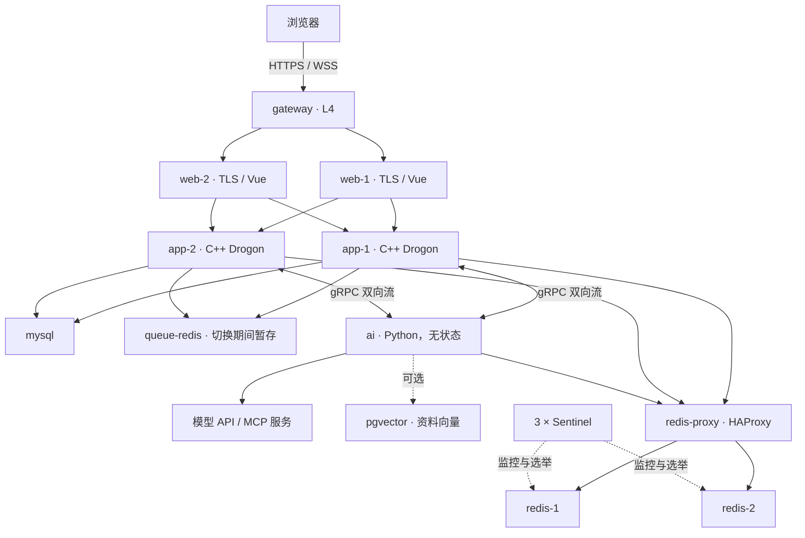
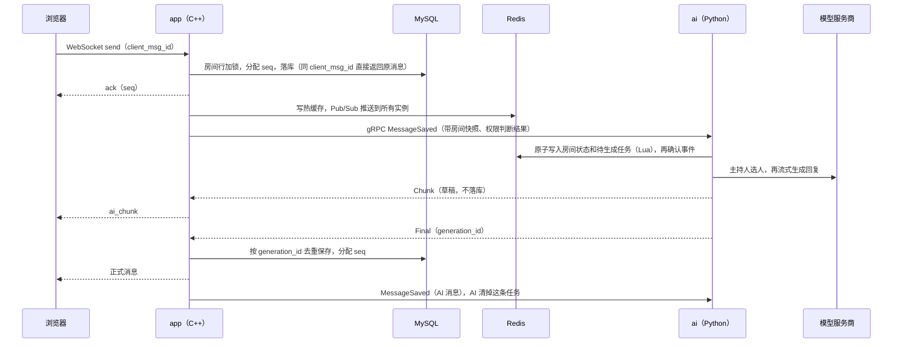

# 架构

- [服务拓扑](#服务拓扑)
- [一条消息的生命周期](#一条消息的生命周期)
- [状态放在哪里](#状态放在哪里)
- [技术栈](#技术栈)
- [为什么用 C++](#为什么用-c)
- [为什么不用现成的编排框架](#为什么不用现成的编排框架)
- [工程亮点](#工程亮点)
- [目录结构](#目录结构)
- [路线图](#路线图)

## 服务拓扑

| 服务 | 职责 | 对外端口 |
|---|---|---|
| `gateway` | L4 入口，按源 IP 一致性哈希到两个 L7，保留真实地址 | 8080（只做跳转）、8443 |
| `web-1`、`web-2` | 结束 TLS，提供前端静态文件，把 HTTP 和 WebSocket 代理到应用 | — |
| `app-1`、`app-2` | C++ 聊天服务：账号、房间、消息、推送、文字指令和权限；任一实例都能处理任何请求 | — |
| `ai` | Python AI 服务：决定谁发言、调用模型、摘要与记忆、资料检索、工具调用 | — |
| `mysql` | 持久数据，用 Flyway 管理迁移 | — |
| `redis-1`、`redis-2`，加 3 个 Sentinel | 会话、限流、AI 状态；1 主 1 从，Sentinel 自动选主 | — |
| `redis-proxy` | HAProxy，只转发到当前主节点，切主时应用不用重启 | — |
| `queue-redis` | 独立的纯内存暂存桶，Redis 切主期间暂存业务请求 | — |
| `pgvector` | 可选，资料库的向量，只在 `knowledge` profile 下启动 | — |
| `certs`、`migrate`、`db-users` | 一次性准备任务：生成本地证书、执行迁移、配置 AI 数据库账号 | — |

## 一条消息的生命周期

以“用户在协作房间里 @ 一个 AI”为例：

几个关键点：

- **确认之前先持久化**：C++ 先把消息落库再回 ack；AI 服务先把状态和任务原子写进 Redis 再确认事件。C++ 会重发超时未确认的事件，AI 服务按事件编号去重。
- **AI 回复只保存一次**：Final 会一直重投，直到 C++ 确认保存；重复投递按 `generation_id` 去重。
- **任务有租约**：生成中的任务带租约并定期续期。进程崩溃后租约到期，任务被重新认领，从头生成。

## 状态放在哪里

| 状态 | 位置 | 说明 |
|---|---|---|
| 消息、房间、成员、账号 | MySQL | 唯一事实来源，`seq` 只由 C++ 分配 |
| 会话、限流、热缓存 | Redis | 丢失可以恢复：会话重新登录，缓存从 MySQL 回填 |
| AI 房间状态、待生成任务、租约 | Redis `ai:room:*` | 用 Lua 原子提交；AI 进程本身不保存状态 |
| 表决、待确认步骤、小会预算 | Redis | 带轮次或编号，状态转换原子执行，重启后补处理只发生一次 |
| 历史摘要、记忆、资料 | MySQL（摘要另有 Redis 热副本）、pgvector | 记忆和资料可以通过接口查看、删除 |
| 切换期间的业务请求 | queue-redis | 纯内存暂存，入队不代表成功，客户端凭排队编号查询结果 |

## 技术栈

| 层 | 技术 |
|---|---|
| 聊天服务 | C++20、Drogon 1.9.13（协程）、gRPC 1.51、Ubuntu 24.04 |
| AI 服务 | Python 3.12、grpcio 1.85、redis-py 8.1、aiomysql、OpenAI / Anthropic / Gemini 官方 SDK、MCP Python SDK 2.3 |
| 前端 | Vue 3.5、Vite、marked + DOMPurify |
| 存储 | MySQL 8.4.6、Redis 7.4.5（Sentinel）、pgvector（PostgreSQL 16，可选） |
| 入口与代理 | Nginx 1.27.5（L4 网关和 L7）、HAProxy 3.0.5 |
| 迁移与部署 | Flyway 11.14.1、Docker Compose |
| 规格与测试 | OpenSpec、pytest、Drogon test、Vitest |

## 为什么用 C++

一个以 AI 为卖点的项目，主体却用 C++ 写，下面说明为什么这样分工。

### 聊天核心是热路径，而且对正确性要求最严

每条消息都要在房间锁内分配 `seq`、落库、写热缓存、跨实例推送，还要按 `client_msg_id` 去重；同时要撑住大量长连接的 WebSocket。这一层的延迟和每个连接的内存开销，决定了“多人实时”能不能成立。

在 Docker Desktop（arm64，10 核，8 GB，测试端和服务端在同一台机器上）上的压测结果：32 个房间并发发送，约每秒 4600 条，p99 约 12 ms，全程没有错误。这个数字只能作为相对参考，测试方法见[压测](operations.md#压测)。

### 按“要快、要严”和“要生态”切开

模型调用以秒计，瓶颈在服务商，不在本地代码。AI 这一层需要的是生态：各家官方 SDK、MCP SDK，以及方便迭代的提示词和解析逻辑，所以用 Python。两边用 gRPC 契约隔开，带来三点好处：

- **故障隔离**：AI 服务崩溃、升级、重启都不影响聊天。
- **强制无状态**：语言边界迫使 AI 服务把状态放进 Redis，这是“断了能续跑”的前提。
- **权限只判断一次**：顺序和权限这类必须正确的事只在 C++ 做。AI 服务不读用户表和房间表，它的数据库账号按最小权限授权，有测试守着。

### 这是一个学习 C++ 后端的项目

这也是最初的出发点：用一个真实、完整的系统，练习 C++20 协程、高并发网络服务、分布式一致性和故障恢复。

## 为什么不用现成的编排框架

[LangGraph](https://github.com/langchain-ai/langgraph) 已经提供了持久执行（检查点、中断后续跑）和人在回路（`interrupt`）。AutoGen、AgentScope 这类框架也能做多 agent 对话。Tablefork 没有拿它们当运行时，原因有三：

- **事实来源只能有一个。**Tablefork 的对话就是房间里按 `seq` 排好的消息，存在 MySQL，由 C++ 分配序号。如果再引入框架自己的检查点存储，同一段对话就会有两份状态，要处理两者不一致的问题。
- **工作单位不同。**编排框架以“一次图执行或一个线程”为单位推进；Tablefork 的工作单位是“房间里的一个事件”。事件来自多个聊天实例，要跟人的消息交错、能被暂停或停止、能被别的实例接手。用 Redis 加租约直接表达，比套进图执行模型更直接。
- **只参考算法和提示词。**主持人（AI）、记忆、摘要、资料检索的算法和提示词参考成熟实现翻译过来（来源见[鸣谢](../ACKNOWLEDGEMENTS.md)），执行仍然走自己的任务和租约。

代价是这些能力都要自己实现和测试，没法直接用框架生态里现成的节点和集成。

## 工程亮点

- **有序与幂等**：消息按房间 `seq` 有序，客户端按 `client_msg_id` 去重重发；AI 回复按 `generation_id` 去重；事件按实例编号加事件编号去重。
- **高可用**：L4 网关、双 L7、双应用实例；Redis 主从加 3 个 Sentinel 自动选主，HAProxy 只转发到主节点；切主期间业务请求进入共享暂存桶，恢复后限速执行。
- **原子状态转换**：表决、待确认步骤、小会预算都用 Lua 脚本按编号原子更新，重复执行只生效一次。
- **安全**：密码强度与常见密码检查，按地址和按用户名双重限流，受信任设备；用户的 API key 用 AES-256-GCM 加密，只有 AI 服务能解密；AI 服务的数据库账号按最小权限授权。
- **可观测**：结构化阶段日志，HTTP、WebSocket、队列、SQL、Redis、AI 用同一个请求编号串起来。
- **故障测试**：`scripts/test.sh` 在完整环境里依次制造 AI 服务中断、生成中被杀、Redis 主节点宕机和旧主重新加入、web 实例宕机，逐一验证恢复。

## 目录结构

| 路径 | 内容 |
|---|---|
| `src/` | C++ 聊天服务 |
| `ai/` | Python AI 服务：触发规则、主持人、主席团、小会、记忆、资料库、工具、模型适配器、key 加密 |
| `web/` | Vue 前端 |
| `proto/` | C++ 和 AI 服务共用的 gRPC 接口 |
| `migrations/` | 数据库迁移，由 Flyway 执行 |
| `data/` | 常见密码列表、桌型模板 |
| `docker/` | Nginx、HAProxy 配置和 Drogon 补丁 |
| `scripts/` | 测试脚本、AI 账号授权脚本 |
| `tests/` | C++ 单元测试和集成测试 |
| `openspec/` | 行为规格和每次变更的设计 |
| `docs/` | 文档 |

## 路线图

- [ ] 协作界面：表决卡片、确认按钮、小会树、记忆和资料管理面板
- [ ] 父房间可选择“等小会结论再继续”
- [ ] 本地向量模型（不依赖外部向量服务）
- [ ] 更多桌型模板，以及按阶段推进的桌型流程
